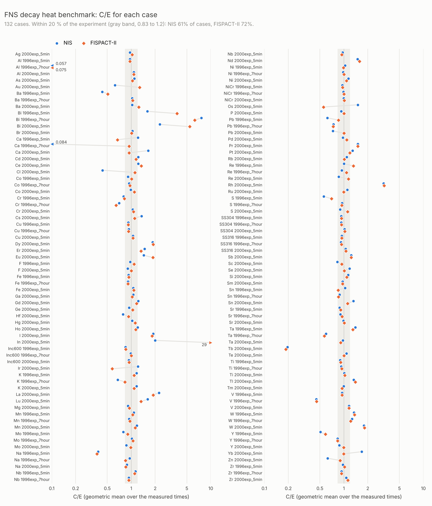

# NIS


Nuclear Inventory Simulator


## Dependencies

- Eigen (For matrix manipulation and solvers)
- ENDFtk (For reading ENDF files)
- Catch2 (For unit testing)

ENDFtk has its own dependencies, which are all header only but need to be pulled locally too.

All dependencies are header only, so only include paths need to be set.


If you follow the script in `docker/setup_local_deps.sh`, running it in the root directory of this repository, it should setup all the correct dependencies as needed.


## Build

Once you have all the dependencies locally, you can then compile via:

```bash
mkdir build
cd build
cmake -DCMAKE_BUILD_TYPE=Release ..
make -j4
```


### python bindings

There are 2 ways to build the python module `pynis`. Use only one of them.

#### Way 1: uv (recommended)

[uv](https://docs.astral.sh/uv/) builds `pynis` and installs it, with numpy, scipy, pytest and matplotlib,
into the folder `.venv` of this project. You do not run CMake, and you do not set `PYTHONPATH`.

1. Build and install (run it again after each change to the C++ code):

    ```bash
    uv sync
    ```

2. Run python with `uv run`:

    ```bash
    uv run python                                   # a python shell, "import pynis" works
    uv run pytest src/tests/python/testsuite.py     # the tests
    # a script, for example the FNS benchmark (see "FNS decay heat benchmark" below)
    uv run python scripts/fns_benchmark.py --fns-dir benchmarks/fns \
        --decay-data data/jeff311.dec --reaction-data data/jeff4.reac --output fns.csv
    ```

    Or activate the env one time in your shell, then use `python` and `pytest` as usual:

    ```bash
    source .venv/bin/activate
    python -c "import pynis"
    ```

**Important:** `pynis` is only in `.venv`. If you type `python3` without `uv run` and without activating `.venv`,
you get your system python, and `import pynis` gives `ModuleNotFoundError`.

**Python version:** uv uses the version in [.python-version](.python-version) (3.14). It downloads that version
if you do not have it. Your system python does not change. To use another version:

```bash
uv python pin 3.13     # writes 3.13 to .python-version
uv sync                # makes .venv again, and builds pynis for 3.13
```

If numpy or pytest fail to import (for example "unknown slot ID" or "name 'frozendict' is not defined"),
they do not support that python version yet. Go back to 3.14.

If `PYTHONPATH` is set in your shell (from Way 2), unset it before you use uv: `unset PYTHONPATH`.

#### Way 2: CMake

Make a virtual env with pybind11, numpy and scipy:

```bash
python3 -m venv venv
source venv/bin/activate
python3 -m pip install pybind11 numpy scipy
```

Then build, with the python of the env (`-DPython_EXECUTABLE`). When you change the python version, make a new env
and a new build folder, and do these steps again:

```bash
source venv/bin/activate
mkdir build
cd build
cmake -DCMAKE_BUILD_TYPE=Release -DBUILD_PY_API=ON -DPython_EXECUTABLE=`which python3` -Dpybind11_DIR=`pybind11-config --cmakedir` ..
make -j4
```

The module is then in `build/bin/python3`. Add that folder to `PYTHONPATH`, and use the python of the env:

```bash
export PYTHONPATH=$PWD/bin/python3
python3 -c "import pynis"
```

`-DBUILD_TOOLS=OFF` builds only the library and the python module, not the `nis` programs.


## Example

To test your build, after compiling as above, try the following:

```bash
./build/bin/nis --decay-data ./data/jeff311.dec --reaction-data ./data/jeff4.reac --input examples/h3_halflife.inp
```

If successful, you should see roughly half remains as H3 and the other half has beta decayed to He3.

```bash
H3 5.00518e+19
He3 4.99482e+19
```


After the nuclides, the output gives the total activity (Bq) and the decay heat (W).
The decay heat comes from the average decay energies in the decay data (MF=8, MT=457), split into
light particles (beta, electrons), electromagnetic (gamma, x-rays) and heavy particles (alpha, recoil).

For neutron activation, add a `spectrum` to the input (see [examples/activate.inp](examples/activate.inp)) and give the reaction data too:

```bash
./build/bin/nis --decay-data ./data/jeff311.dec --reaction-data ./data/jeff4.reac --input examples/activate.inp
```

The spectrum is the neutron flux in n/cm^2/s per group. The first line gives the group bounds in eV (ascending), the second line gives one value per group.
The reaction data must be group-wise (INT=1), for example as processed by NJOY GROUPR.

Reading the ENDF reaction file (about 1 GB for JEFF-4) takes a few seconds for each run. Make a binary cache
of it one time, then give the cache to `nis` (or to the Python `reaction_data_from_file`) in place of the ENDF file:

```bash
./build/bin/nis_cache --reaction-data ./data/jeff4.reac --output ./data/jeff4.nisreac
./build/bin/nis --decay-data ./data/jeff311.dec --reaction-data ./data/jeff4.nisreac --input examples/activate.inp
```

`nis` finds from the file header if it is a cache or an ENDF file. Make the cache again when the ENDF file
changes, or after an update of NIS that changes the cache version. The cache uses the byte order of the machine that made it.

For more than one step, give one `dt` line for each step, in order, with the step length in seconds and the total flux in n/m^2/s:

```
dt 3600 1e14
dt 60 0
dt 600 0
```

The spectrum is normalised to the flux of each step, so it only gives the shape. A flux of 0 is a cooling step (decay only).
A `dt` line with no flux uses the spectrum as it is given (or decay only if there is no spectrum).
With more than one step, the output gives the nuclides, activity and decay heat after each step, under a
`step <n>` line with the time since the start and the flux.

Note, you will need to have pulled the decay data via LFS in the [./data](./data) subdirectory.

### Fission yields

Without fission yields, a fission (MT=18) goes to the sink: the fissile nuclide is lost, but no fission products are made.
Give a fission yield file (ENDF MF=8 MT=454, the independent yields) to make the fission products:

```bash
# get the JEFF-3.1.1 yields from the NEA data bank: data/jeff311.nfy and data/jeff311.sfy (needs curl)
python scripts/get_fission_yields.py
./build/bin/nis -d data/jeff311.dec -r data/jeff4.nisreac -i run.inp \
    --fission-yields data/jeff311.nfy --sf-yields data/jeff311.sfy
```

- `--fission-yields` (`-y`): neutron induced fission. Each fission makes each product at the fission rate times its
  independent yield. The decay data then makes the rest of each decay chain.
- `--sf-yields`: spontaneous fission (decay mode 6) makes the fission products too, at the partial decay rate times the yield.
- A nuclide that has no yields in the file still goes to the sink. So does a product that NIS does not track.
  A product isomer that NIS does not track goes to the ground state.

The yields are given at a few incident energies (for JEFF-3.1.1: thermal, 400 keV or 500 keV, and 14 MeV).
For each energy group of the fission cross section, NIS takes the yields at the middle of the group (in lethargy),
with linear interpolation in energy between the yield energies, and the nearest set outside them. The groups are
weighted by their fission rate. So a thermal spectrum uses the thermal yields, and a 14 MeV spectrum the 14 MeV yields.

In Python:

```python
yields = nis.core.fission_yields_from_file("data/jeff311.nfy")
reaction_mat = nis.core.reaction_mat(reaction_data, spectrum, yields)
decay_mat = nis.core.decay_mat_from_file("data/jeff311.dec", nis.core.fission_yields_from_file("data/jeff311.sfy"))
```


## Tests

### C++ tests

```bash
./build/bin/nistests
```

They need no nuclear data. They test the solver, the steps of an input (irradiation and cooling), the input
reader (also all the FNS decks in `benchmarks/fns`), ENDF reading, the reaction matrix, fission yields and the reaction cache.

### Python tests

They need the python bindings (see [python bindings](#python-bindings)):

```bash
uv run pytest src/tests/python/testsuite.py                    # all the tests
uv run pytest -m "not slow" src/tests/python/testsuite.py      # only the fast tests (less than 30 s)
uv run pytest -m slow src/tests/python/testsuite.py            # only the slow tests (about 1 min)
```

With the CMake build, set `PYTHONPATH` first and use `pytest` in place of `uv run pytest`:

```bash
export PYTHONPATH=./build/bin/python3
pytest src/tests/python/testsuite.py
```

The tests:

| File | What it tests | Needs |
|---|---|---|
| [scripttests.py](src/tests/python/scripttests.py) | the benchmark scripts: read a deck, interpolation, statistics, when the reaction cache is made again | nothing |
| [integrationtests.py](src/tests/python/integrationtests.py) | decay with JEFF-3.1.1 and ENDF/B-VII.1 | decay data |
| [reactiontests.py](src/tests/python/reactiontests.py) | JEFF-4.0 reactions: thermal and 14.1 MeV cross sections against reference values, the spectrum (linear in flux, bin splitting), the matrix structure, burn-up and Co60 activation against the analytic Bateman solution | reaction data |
| [fissiontests.py](src/tests/python/fissiontests.py) | JEFF-3.1.1 fission yields: 2 products per fission, thermal U235 gives the known Cs137 and Sr90 yields and fission to capture ratio, Cf252 spontaneous fission | decay and reaction data, the yield files |
| [fnstests.py](src/tests/python/fnstests.py) (slow) | FNS regression: runs all 132 FNS decks and compares with [nis_reference.csv](benchmarks/fns/nis_reference.csv), and checks that NIS stays as close to the experiment as now | decay and reaction data |
| [nisprogramtests.py](src/tests/python/nisprogramtests.py) (slow) | the `nis` program: 3 FNS decks give the same as the reference, decay only steps, errors for bad input | decay and reaction data, the `nis` program |

"Decay data" and "reaction data" are the files in `data/` from git lfs. The yield files come from
`python scripts/get_fission_yields.py`. A test that needs a file that is not there
is skipped. The `nis` program test uses `build/bin/nis`, or give its path: `NIS_BIN=path/to/nis`.

**When the FNS regression test fails:** a change to the code or to the data changed the decay heat (more than
1e-4, relative). The test gives the first values that changed. If the change is intended, make the reference again
and commit it:

```bash
uv run python scripts/fns_benchmark.py --fns-dir benchmarks/fns \
    --decay-data data/jeff311.dec --reaction-data data/jeff4.reac --output benchmarks/fns/nis_reference.csv
```

### CI

[.github/workflows/tests.yml](.github/workflows/tests.yml) runs on each push to `main`, `master` or `develop`,
and on each pull request:

- it builds NIS and runs the C++ tests, on Linux and macOS,
- it builds `pynis` with uv and runs the fast Python tests, on Linux.

CI does not download the nuclear data (about 1 GB of git lfs), so the tests that need it are skipped there.
Run them on your machine before you push a change to the physics.

### FNS decay heat benchmark

The FNS (JAEA) experiments irradiate foils with 14 MeV neutrons and measure the decay heat.
The scripts run NIS for each case and compare it with the measured heat and with the FISPACT-II
(TENDL-2017) results. FISPACT-II is not run.

The input for each case is in [benchmarks/fns](benchmarks/fns): one NIS input deck `<material>/<case>.inp`
(initial atoms, 709 group flux shape, the irradiation step and a cooling step to each measured time), and the measured
and FISPACT-II decay heat in `<case>.csv`. [scripts/fns_make_decks.py](scripts/fns_make_decks.py) made them from the
FISPACT-II validation inputs.

These steps use uv (see [python bindings](#python-bindings)), and the nuclear data from LFS.

1. Build and install `pynis` into `.venv`:

    ```bash
    uv sync
    ```

2. Run all the cases. The results are in `fns.csv`:

    ```bash
    uv run python scripts/fns_benchmark.py --fns-dir benchmarks/fns \
        --decay-data data/jeff311.dec --reaction-data data/jeff4.reac --output fns.csv
    ```

    The first run makes the reaction cache `data/jeff4.nisreac` (see below). `--materials Co Fe` runs only
    some materials. The cases run in parallel, one process per core (`--jobs`).

3. Get the C/E statistics for NIS and FISPACT-II:

    ```bash
    uv run python scripts/fns_stats.py fns.csv
    ```

4. Make the plots of NIS (smooth curve) and FISPACT-II against the experiment, one for each case:

    ```bash
    uv run python scripts/fns_plot.py --fns-dir benchmarks/fns \
        --decay-data data/jeff311.dec --reaction-data data/jeff4.reac --output-dir fns_plots
    ```

5. Make one plot of the C/E of all the cases, NIS against FISPACT-II:

    ```bash
    uv run python scripts/fns_summary_plot.py fns.csv --output fns_summary.png
    ```

    This is the plot for [nis_reference.csv](benchmarks/fns/nis_reference.csv) (JEFF-3.1.1 decay and JEFF-4.0
    reaction data). Each point is the geometric mean of C/E over the measured times of a case:

    

**Reaction cache:** all the scripts use the reaction cache. If `--reaction-data` is an ENDF file, the cache is
`<file>.nisreac` next to it (for example `data/jeff4.nisreac`). The scripts make it first if it does not exist,
is older than the ENDF file, or is of another cache version.

**With the FISPACT-II validation inputs:** give their folder to `--fns-dir` in place of `benchmarks/fns`
(`<material>/TENDL-2017_<case>.i`, `.out`, `.nuclides`, `<case>.exp` and `<case>_fluxes`). Only these files
have the FISPACT-II atoms, so only with them can you compare the nuclides:

```bash
uv run python scripts/fns_benchmark.py --fns-dir path/to/fns \
    --decay-data data/jeff311.dec --reaction-data data/jeff4.reac \
    --output fns.csv --nuclides-output fns_nuclides.csv
# the nuclides that cause a difference between NIS and FISPACT-II
uv run python scripts/fns_heat_by_nuclide.py fns_nuclides.csv --decay-data data/jeff311.dec
# make the decks in benchmarks/fns again
uv run python scripts/fns_make_decks.py --fns-dir path/to/fns --output-dir benchmarks/fns
```

**With the `nis` program:** [scripts/fns_run_decks.py](scripts/fns_run_decks.py) runs each deck with the `nis`
program, in place of `pynis`. uv does not build `nis`, so build it with CMake first (see [Build](#build)).
It writes the same CSV:

```bash
./build/bin/nis -d data/jeff311.dec -r data/jeff4.nisreac -i benchmarks/fns/Co/2000exp_5min.inp   # one deck
uv run python scripts/fns_run_decks.py --nis build/bin/nis --decks benchmarks/fns \
    --decay-data data/jeff311.dec --reaction-data data/jeff4.reac --output fns_decks.csv
uv run python scripts/fns_stats.py fns_decks.csv
```

Each `nis` run reads the nuclear data again, so the reaction cache is important here: with it, all the decks run in
about 30 s on 4 cores. The cache is made with the `nis_cache` program next to `--nis` (or give `--nis-cache`).
