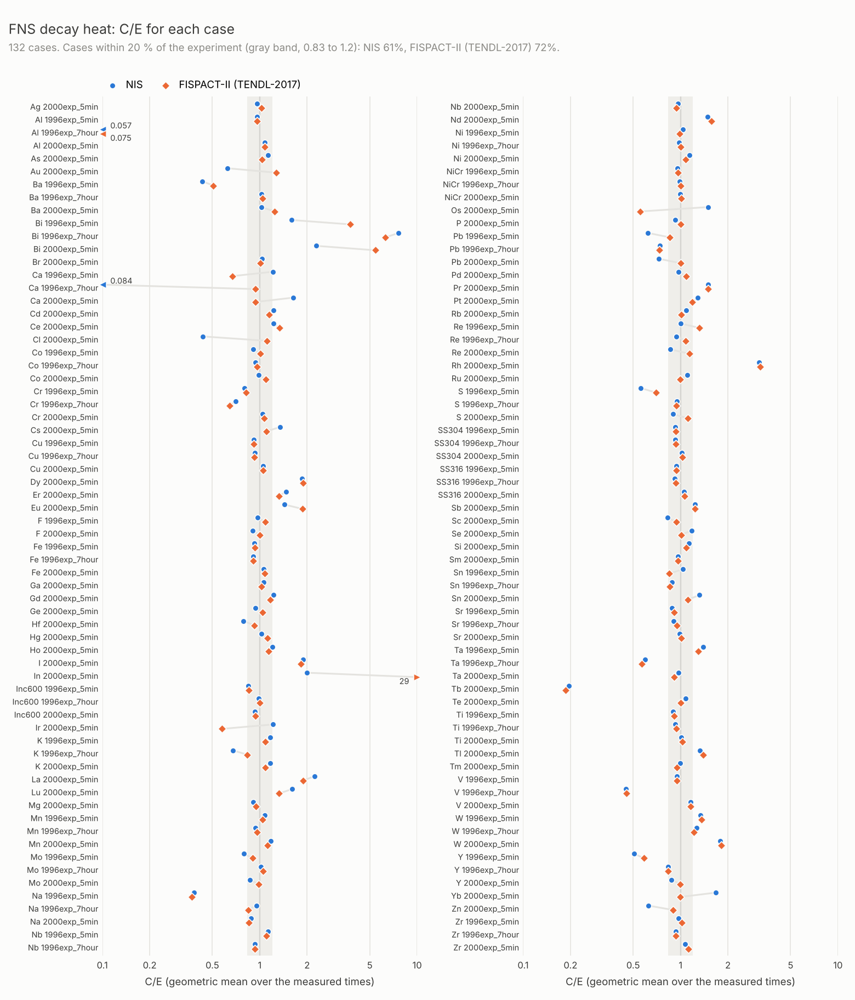

# NIS


Nuclear Inventory Simulator


## Dependencies

- Eigen (For matrix manipulation and solvers)
- ENDFtk (For reading ENDF files)
- Catch2 (For unit testing)

ENDFtk has its own dependencies, which are all header only but need to be pulled locally too.

All dependencies are header only, so only include paths need to be set.


If you follow the script in `docker/setup_local_deps.sh`, running it in the root directory of this repository, it should setup all the correct dependencies as needed.


## Build

Once you have all the dependencies locally, you can then compile via:

```bash
mkdir build
cd build
cmake -DCMAKE_BUILD_TYPE=Release ..
make -j4
```


### python bindings

There are 2 ways to build the python module `pynis`. Use only one of them.

#### Way 1: uv (recommended)

[uv](https://docs.astral.sh/uv/) builds `pynis` and installs it, with numpy, scipy, pytest and matplotlib,
into the folder `.venv` of this project. You do not run CMake, and you do not set `PYTHONPATH`.

1. Build and install (run it again after each change to the C++ code):

    ```bash
    uv sync
    ```

    `uv sync` builds `pynis` again when a file in `src/` (`.cpp`, `.hpp`, `CMakeLists.txt`) changes, or `pyproject.toml`.
    To make it build again in all cases: `uv sync --reinstall-package pynis`.
    `uv sync` does not build the `nis` program (`build/bin/nis`) or the C++ tests. For them, use CMake (Way 2).

2. Run python with `uv run`:

    ```bash
    uv run python                                   # a python shell, "import pynis" works
    uv run pytest src/tests/python/testsuite.py     # the tests
    # a script, for example the benchmarks (see "Benchmarks" below)
    uv run python scripts/bench.py run fns \
        --decay-data data/jeff311.dec --reaction-data data/jeff4.reac --output results.csv
    ```

    Or activate the env one time in your shell, then use `python` and `pytest` as usual:

    ```bash
    source .venv/bin/activate
    python -c "import pynis"
    ```

**Important:** `pynis` is only in `.venv`. If you type `python3` without `uv run` and without activating `.venv`,
you get your system python, and `import pynis` gives `ModuleNotFoundError`.

**Python version:** uv uses the version in [.python-version](.python-version) (3.14). It downloads that version
if you do not have it. Your system python does not change. To use another version:

```bash
uv python pin 3.13     # writes 3.13 to .python-version
uv sync                # makes .venv again, and builds pynis for 3.13
```

If numpy or pytest fail to import (for example "unknown slot ID" or "name 'frozendict' is not defined"),
they do not support that python version yet. Go back to 3.14.

If `PYTHONPATH` is set in your shell (from Way 2), unset it before you use uv: `unset PYTHONPATH`.

#### Way 2: CMake

Make a virtual env with pybind11, numpy and scipy:

```bash
python3 -m venv venv
source venv/bin/activate
python3 -m pip install pybind11 numpy scipy
```

Then build, with the python of the env (`-DPython_EXECUTABLE`). When you change the python version, make a new env
and a new build folder, and do these steps again:

```bash
source venv/bin/activate
mkdir build
cd build
cmake -DCMAKE_BUILD_TYPE=Release -DBUILD_PY_API=ON -DPython_EXECUTABLE=`which python3` -Dpybind11_DIR=`pybind11-config --cmakedir` ..
make -j4
```

The module is then in `build/bin/python3`. Add that folder to `PYTHONPATH`, and use the python of the env:

```bash
export PYTHONPATH=$PWD/bin/python3
python3 -c "import pynis"
```

`-DBUILD_TOOLS=OFF` builds only the library and the python module, not the `nis` programs.


## Quick start: the benchmarks in 4 steps

The [Makefile](Makefile) does all of it: get the dependencies, build, get and process the nuclear data, run the
benchmark for each library and compare the results.

```bash
make setup      # the C++ dependencies, NIS (CMake) and pynis (uv)
make data       # the decay data, and the reaction data of each library (NJOY and PREPRO: hours the first time)
make bench      # run the FNS benchmark for each reaction library, all with the same decay data
make compare    # results/stats.txt and results/summary.png
```

Choose the data with `REACTIONS` (`jeff4`, `tendl<year>`) and `DECAY` (`jeff311`, `jeff4`, `endfbvii1`, `endfbviii0`):

```bash
make compare REACTIONS="jeff4 tendl2025" DECAY=jeff4     # the default
make compare REACTIONS=jeff4 DECAY=jeff311
```

Each run is in `results/<benchmark>-<reactions>+<decay>.csv`, with the label `<reactions>+<decay>`, so the runs
can not be mixed up. `make` does a run again only when its data changes. Other targets: `make test-data` (the
files that the tests need), `make test`, `make clean-results`. `JOBS=8` sets the number of cores.

## Nuclear data

The nuclear data is not in git. [processing/process.py](processing/process.py) downloads it from the
NEA data bank (data.oecd-nea.org) and the NNDC (www.nndc.bnl.gov), checks the MD5 of each file, and writes the
NIS data files into `data/`. It needs only Python 3.9 or newer (no other packages).

```bash
python3 processing/process.py bootstrap --no-reactions   # the decay data and the fission yields, a few minutes
python3 processing/process.py bootstrap                  # and data/jeff4.reac too, some hours (NJOY and PREPRO)
```

`bootstrap` gets the files that the tests and the examples use:

| File | What | From |
|---|---|---|
| `data/jeff311.dec` | JEFF-3.1.1 decay data | NEA |
| `data/endfbvii1.dec` | ENDF/B-VII.1 decay data | NNDC |
| `data/jeff311.nfy`, `data/jeff311.sfy` | JEFF-3.1.1 neutron induced and spontaneous fission yields | NEA |
| `data/jeff4.reac` | JEFF-4.0 neutron cross sections in 1102 groups, made from the raw ENDF files with NJOY and PREPRO | NEA |

`bootstrap` builds NJOY and PREPRO first if they are not there (it needs git, cmake, make and gfortran, see
[processing/README.md](processing/README.md)). A file that is already in `data/` is not made again (`--force` makes it again).

You can get other libraries too:

```bash
python3 processing/process.py libraries            # the libraries and their files
python3 processing/process.py decay jeff4 endfbviii0   # data/jeff4.dec and data/endfbviii0.dec
python3 processing/process.py yields jeff4             # data/jeff4.nfy and data/jeff4.sfy
python3 processing/process.py reactions jeff4          # data/jeff4.reac
python3 processing/process.py tendl --year 2025        # data/tendl2025.reac
```

| Library | Decay | Fission yields | Neutron cross sections |
|---|---|---|---|
| `jeff311` (JEFF-3.1.1) | yes | yes | |
| `jeff4` (JEFF-4.0) | yes | yes | yes |
| `endfbvii1` (ENDF/B-VII.1) | yes | | |
| `endfbviii0` (ENDF/B-VIII.0) | yes | | |
| TENDL (`tendl` command) | | | yes |

The reaction data files have the version of the processing in their first line (`nisdata 3`). A file or a
processed folder (`processing/out/<library>`) of an older version is made again. Version 3 adds the products of
MT=5 (n,anything), which the files of version 1 do not have (version 2 had an error in them, and is never used).
For TENDL, MT=5 starts at 30 MeV, so a version 1 file gives the same results for a spectrum below 30 MeV (FNS):
`--allow-old` (or `make ... ALLOW_OLD=1`) uses it as it is. For JEFF-4.0, MT=5 starts lower (Mn55: 0.6 MeV).
`tendl` uses the unpacked folder `processing/raw/TENDL-<year>-n/` if the archive is not there (no new download).

Some files need small changes before ENDFtk can read them. The program makes them, and they do not change the data that NIS uses:
the JEFF-4.0 yield files get a first line (TPID), and one gamma line of the JEFF-4.0 decay data (`NT=8`) gets
two empty conversion coefficients (`NT=12`).

## Example

To test your build, after compiling as above, try the following:

```bash
./build/bin/nis --decay-data ./data/jeff311.dec --reaction-data ./data/jeff4.reac --input examples/h3_halflife.inp
```

If successful, you should see roughly half remains as H3 and the other half has beta decayed to He3.

```bash
H3 5.00518e+19
He3 4.99482e+19
```


After the nuclides, the output gives the total activity (Bq) and the decay heat (W).
The decay heat comes from the average decay energies in the decay data (MF=8, MT=457), split into
light particles (beta, electrons), electromagnetic (gamma, x-rays) and heavy particles (alpha, recoil).

For neutron activation, add a `spectrum` to the input (see [examples/activate.inp](examples/activate.inp)) and give the reaction data too:

```bash
./build/bin/nis --decay-data ./data/jeff311.dec --reaction-data ./data/jeff4.reac --input examples/activate.inp
```

The spectrum is the neutron flux in n/cm^2/s per group. The first line gives the group bounds in eV (ascending), the second line gives one value per group.
The reaction data must be group-wise (INT=1), for example as processed by NJOY GROUPR.
To make it from the raw ENDF files of a library (for example the latest TENDL), with NJOY and PREPRO on all the
cores, see [processing/README.md](processing/README.md):

```bash
python3 processing/process.py tools                   # build NJOY and PREPRO
python3 processing/process.py tendl --year 2025       # data/tendl2025.reac and data/tendl2025.nisreac
```

Reading the ENDF reaction file (about 1 GB for JEFF-4) takes a few seconds for each run. Make a binary cache
of it one time, then give the cache to `nis` (or to the Python `reaction_data_from_file`) in place of the ENDF file:

```bash
./build/bin/nis_cache --reaction-data ./data/jeff4.reac --output ./data/jeff4.nisreac
./build/bin/nis --decay-data ./data/jeff311.dec --reaction-data ./data/jeff4.nisreac --input examples/activate.inp
```

`nis` finds from the file header if it is a cache or an ENDF file. Make the cache again when the ENDF file
changes, or after an update of NIS that changes the cache version. The cache uses the byte order of the machine that made it.

For more than one step, give one `dt` line for each step, in order, with the step length in seconds and the total flux in n/m^2/s:

```
dt 3600 1e14
dt 60 0
dt 600 0
```

The spectrum is normalised to the flux of each step, so it only gives the shape. A flux of 0 is a cooling step (decay only).
A `dt` line with no flux uses the spectrum as it is given (or decay only if there is no spectrum).
With more than one step, the output gives the nuclides, activity and decay heat after each step, under a
`step <n>` line with the time since the start and the flux.

Note, you need the nuclear data in `data/` first (see [Nuclear data](#nuclear-data)).

### Fission yields

Without fission yields, a fission (MT=18) goes to the sink: the fissile nuclide is lost, but no fission products are made.
Give a fission yield file (ENDF MF=8 MT=454, the independent yields) to make the fission products:

```bash
# get the JEFF-3.1.1 yields from the NEA data bank: data/jeff311.nfy and data/jeff311.sfy
python3 processing/process.py yields jeff311
./build/bin/nis -d data/jeff311.dec -r data/jeff4.nisreac -i run.inp \
    --fission-yields data/jeff311.nfy --sf-yields data/jeff311.sfy
```

- `--fission-yields` (`-y`): neutron induced fission. Each fission makes each product at the fission rate times its
  independent yield. The decay data then makes the rest of each decay chain.
- `--sf-yields`: spontaneous fission (decay mode 6) makes the fission products too, at the partial decay rate times the yield.
- A nuclide that has no yields in the file still goes to the sink. So does a product that NIS does not track.
  A product isomer that NIS does not track goes to the ground state.

The yields are given at a few incident energies (for JEFF-3.1.1: thermal, 400 keV or 500 keV, and 14 MeV).
For each energy group of the fission cross section, NIS takes the yields at the middle of the group (in lethargy),
with linear interpolation in energy between the yield energies, and the nearest set outside them. The groups are
weighted by their fission rate. So a thermal spectrum uses the thermal yields, and a 14 MeV spectrum the 14 MeV yields.

In Python:

```python
yields = nis.core.fission_yields_from_file("data/jeff311.nfy")
reaction_mat = nis.core.reaction_mat(reaction_data, spectrum, yields)
decay_mat = nis.core.decay_mat_from_file("data/jeff311.dec", nis.core.fission_yields_from_file("data/jeff311.sfy"))
```

### Change the nuclear data (Python API)

The matrices are made from data types that do not depend on ENDF (C++: [src/nis/data](src/nis/data), namespace `nis::data`).
ENDF ([src/nis/endf](src/nis/endf)) is only one way to fill them. You can read the data from a file, change it, or make it
by hand, and then make the matrices from it:

| Data | Type | Read from a file | Make the matrix |
|---|---|---|---|
| Decay | `DecayData`: a dict of `DecayNuclide` by ZAI | `decay_data_from_file` | `decay_mat(decay_data, sf_yields=None)`, `decay_energy_data(decay_data)` |
| Cross sections | `ReactionData`: a list of `CrossSection` | `reaction_data_from_file` | `reaction_mat(reaction_data, spectrum, fission_yields=None)` |
| Fission yields | `FissionYieldData`: a dict of `FissionYields` by parent ZAI | `fission_yields_from_file` | (given to the two functions above) |

```python
import pynis as nis
core = nis.core
co60 = nis.zai.get_from_name("Co60")

# decay: change a half-life (s) and the decay modes
decay_data = core.decay_data_from_file("data/jeff311.dec")
decay_data[co60].half_life = 1.5e8
decay_data[co60].modes = [core.DecayMode(rtyp=1, branching_ratio=0.9),      # beta-
                          core.DecayMode(rtyp=10, branching_ratio=0.1)]     # unknown, to the sink
decay_data[co60].modes[0].branching_ratio = 0.95                            # change one mode in place
decay_data[nis.zai.get_from_name("H3")] = core.DecayNuclide(half_life=3.9e8, modes=[core.DecayMode(1, 1.0)])
decay_mat = core.decay_mat(decay_data)
energy_data = core.decay_energy_data(decay_data)   # for activity and decay heat

# cross sections: change, add or remove a reaction (ENDF MT number, group bounds in eV, values in barns)
reaction_data = core.reaction_data_from_file("data/jeff4.nisreac")
fe56 = nis.zai.get_from_name("Fe56")
for xs in reaction_data.find(fe56, 102):          # (n,g)
    xs.values = [1.1*v for v in xs.values]
reaction_data.remove_reactions(fe56, 103)         # no (n,p)
reaction_data.append(core.CrossSection(fe56, 107, [1e6, 2e7], [0.05, 0.05]))   # (n,a)
reaction_mat = core.reaction_mat(reaction_data, spectrum)

# fission yields: one dict (product ZAI -> independent yield) for each incident energy (eV)
yields = core.fission_yields_from_file("data/jeff311.nfy")
u235 = nis.zai.get_from_name("U235")
yields[u235] = core.FissionYields(u235, [0.0253], [{561400: 0.06, 421000: 0.06}])
reaction_mat = core.reaction_mat(reaction_data, spectrum, yields)
```

Notes:

- `decay_data[zai]`, `reaction_data[i]`, `reaction_data.find(...)` and `yields[zai]` give the item in the data, not a copy,
  so a change to them changes the data. Do not keep them after you add items to `reaction_data`.
- List fields (`CrossSection.energies` and `values`, `FissionYields.energies` and `yields`) are copies in Python.
  Set them as a whole (`xs.values = new_values`), not one item at a time. `DecayNuclide.modes` is not a copy.
- `DecayMode.rtyp` uses the ENDF decay numbers: 0 gamma, 1 beta-, 2 beta+/EC, 3 IT, 4 alpha, 5 neutron,
  6 spontaneous fission, 7 proton, 10 unknown (to the sink). 1.5 is beta- then neutron emission.
- A half-life of infinity (or 0) is stable. `DecayNuclide.decay_constant` can be read and set too.
- NIS does not check the branching ratios. `DecayNuclide.total_branching_ratio` gives their sum.
- Only nuclides in `nis.data.ALL_ZAIS()` are in the matrices. A product that is not tracked goes to the sink.

To solve irradiation and cooling steps, use `compute_steps`. Each step starts from the result of the step before,
and it gives one result for each step. The flux of a step is in n/m^2/s, like in the input files:

```python
model = core.BasicModel()
model.nuclides = {"Co59": 1e20}
model.spectrum = spectrum                        # the spectrum of reaction_mat, in n/cm^2/s
model.steps = [core.TimeStep(3600.0, 1e17),      # 1 hour at 1e17 n/m^2/s
               core.TimeStep(86400.0, 0.0),      # 1 day of cooling
               core.TimeStep(3600.0)]            # 1 hour with the spectrum as it is given
results = core.compute_steps(model, decay_mat, reaction_mat)   # no reaction_mat is decay only
```

The flux of a step scales the reaction matrix by `flux_scale(step, spectrum_total)`. By default, `spectrum_total` is the total of
`model.spectrum`. You can also give `spectrum_total` and `solver` (default `solver_cram48`).

For a full example that needs no data files, see [examples/python/tritium_decay.py](examples/python/tritium_decay.py).
It makes the H3 decay data by hand, then gives the inventory, activity and decay heat for 5 half-lives:

```bash
uv run python examples/python/tritium_decay.py
```


## Tests

### C++ tests

```bash
./build/bin/nistests
```

They need no nuclear data. They test the solver, the steps of an input (irradiation and cooling), the input
reader (also all the benchmark decks in `benchmarks/`), ENDF reading, the reaction matrix, fission yields and the reaction cache.

### Python tests

They need the python bindings (see [python bindings](#python-bindings)):

```bash
uv run pytest src/tests/python/testsuite.py                    # all the tests
uv run pytest -m "not slow" src/tests/python/testsuite.py      # only the fast tests (less than 30 s)
uv run pytest -m slow src/tests/python/testsuite.py            # only the slow tests (about 1 min)
```

With the CMake build, set `PYTHONPATH` first and use `pytest` in place of `uv run pytest`:

```bash
export PYTHONPATH=./build/bin/python3
pytest src/tests/python/testsuite.py
```

The tests:

| File | What it tests | Needs |
|---|---|---|
| [scripttests.py](src/tests/python/scripttests.py) | the benchmark format and tools: read and check case files, the decks are made from the case files, units, results files, statistics, the `bench.py` commands, when the reaction cache is made again | nothing |
| [processingtests.py](src/tests/python/processingtests.py) | the data processing: ENDF headers, the NJOY and PREPRO inputs, joining files; with NJOY and PREPRO, two nuclides through all the steps and read by NIS | NJOY and PREPRO (`processing/process.py tools`) for some tests |
| [integrationtests.py](src/tests/python/integrationtests.py) | decay with JEFF-3.1.1 and ENDF/B-VII.1 | decay data |
| [solvertests.py](src/tests/python/solvertests.py) | CRAM48 against a 60 digit matrix exponential (mpmath) for random decay matrices, with and without loops | nothing (mpmath, a dev dependency) |
| [datatests.py](src/tests/python/datatests.py) | the decay matrix and decay energies of JEFF-3.1.1 and ENDF/B-VII.1: signs, branching ratios, mass number, known half-lives, isomers, alpha and proton emission, the two libraries against each other | decay data |
| [pulsetests.py](src/tests/python/pulsetests.py) | decay heat after a fission pulse: the integral is the delayed beta and gamma energy of ENDF MT=458 (U233, U235, Pu239, Pu241), the solver steps give the direct integral, JEFF-3.1.1 and ENDF/B-VII.1 decay data agree, a 1 ms irradiation is a pulse | decay data, the yield files (reaction data for one test) |
| [reactiontests.py](src/tests/python/reactiontests.py) | JEFF-4.0 reactions: thermal and 14.1 MeV cross sections against reference values, the spectrum (linear in flux, bin splitting), the matrix structure, burn-up and Co60 activation against the analytic Bateman solution | reaction data |
| [fissiontests.py](src/tests/python/fissiontests.py) | JEFF-3.1.1 fission yields: 2 products per fission, thermal U235 gives the known Cs137 and Sr90 yields and fission to capture ratio, Cf252 spontaneous fission | decay and reaction data, the yield files |
| [fnstests.py](src/tests/python/fnstests.py) (slow) | FNS regression: runs all 132 FNS cases and compares with [nis_reference.csv](benchmarks/fns/results/nis_reference.csv), and checks that NIS stays as close to the experiment as now | decay and reaction data |
| [fissionheattests.py](src/tests/python/fissionheattests.py) | the fission decay heat benchmark: the 44 cases load, the reference has all of them; regression against [nis_reference.csv](benchmarks/fission_decay_heat/results/nis_reference.csv) and C/E limits | the regression: decay data and the yield files |
| [nisprogramtests.py](src/tests/python/nisprogramtests.py) (slow) | the `nis` program: 3 FNS decks give the same as the reference, decay only steps, errors for bad input | decay and reaction data, the `nis` program |

"Decay data", "reaction data" and "the yield files" are the files in `data/` from
`python3 processing/process.py bootstrap` (see [Nuclear data](#nuclear-data)). A test that needs a file that is not there
is skipped. The `nis` program test uses `build/bin/nis`, or give its path: `NIS_BIN=path/to/nis`.

**When the FNS regression test fails:** a change to the code or to the data changed the decay heat (more than
1e-4, relative). The test gives the first values that changed. If the change is intended, make the reference again
and commit it:

```bash
uv run python scripts/bench.py run fns --decay-data data/jeff311.dec --reaction-data data/jeff4.reac \
    --output benchmarks/fns/results/nis_reference.csv
```

### CI

[.github/workflows/tests.yml](.github/workflows/tests.yml) runs on each push to `main`, `master` or `develop`,
and on each pull request:

- it builds NIS and runs the C++ tests, on Linux and macOS,
- it builds `pynis` with uv, gets the decay data and the fission yields (`bootstrap --no-reactions`, cached),
  and runs the fast Python tests, on Linux.

CI does not make the reaction data (it takes hours), so the tests that need it are skipped there.
Run them on your machine before you push a change to the physics.

## Benchmarks

All the benchmarks are in [benchmarks/](benchmarks), in one standard format for all types of benchmark
(fusion, fission, ...). Each case has a case file `<case>.json` (the source of truth: the sample, the time steps,
the spectrum, the measured values and the results of other codes) and a NIS input deck `<case>.inp` made from it.
[benchmarks/README.md](benchmarks/README.md) gives the format, and how to add a benchmark.

| Benchmark | Type | Cases | What is measured |
|---|---|---|---|
| [fns](benchmarks/fns) | fusion | 132 | decay heat of foils after 14 MeV neutron irradiation (FNS, JAEA) |
| [fission_decay_heat](benchmarks/fission_decay_heat) | fission | 44 | beta, gamma and total decay heat after fission pulses and irradiations of U233, U235, U238, Pu239, Pu241 and Th232 (IAEA CoNDERC) |

One program, [scripts/bench.py](scripts/bench.py), does all the work for all the benchmarks. These steps use uv
(see [python bindings](#python-bindings)), and the nuclear data (see [Nuclear data](#nuclear-data)).

1. Build and install `pynis` into `.venv`:

    ```bash
    uv sync
    ```

2. See the benchmarks, and check the case files and the decks:

    ```bash
    uv run python scripts/bench.py list
    uv run python scripts/bench.py check
    ```

3. Run all the cases of a benchmark (or all the benchmarks if you give no name). The results are in `results.csv`:

    ```bash
    uv run python scripts/bench.py run fns \
        --decay-data data/jeff311.dec --reaction-data data/jeff4.reac --output results.csv
    ```

    The first run makes the reaction cache `data/jeff4.nisreac` (see below). `--cases Co Fe/1996exp_7hour` runs
    only some cases. The cases run in parallel, one process per core (`--jobs`). For a fission benchmark, give the
    fission yields with `--fission-yields` (and `--sf-yields`).

4. Get the C/E statistics for NIS and the other codes in the case files (for FNS, FISPACT-II):

    ```bash
    uv run python scripts/bench.py stats results.csv
    ```

    The report has tables: the runs (A, B, ...), how many cases and points are within 10, 20 and 50% of the
    experiment, how well the runs agree with run A, and the cases where they differ most (`--worst 15`), with the
    median uncertainty of the experiment of each case. A case with an uncertainty over 50% can not test the codes
    well (it is yellow, or has a `*`). In a terminal the values have colours: green within 10%, yellow within 50%,
    red for more (`--color always|never`, or set `NO_COLOR`). `--output stats.txt` also writes it with no colours.

5. Make one plot of the C/E of all the cases, and one plot for each case:

    ```bash
    uv run python scripts/bench.py plot results.csv --summary fns_summary.png --cases-dir plots
    ```

    This is the summary plot for the FNS reference results
    [nis_reference.csv](benchmarks/fns/results/nis_reference.csv) (JEFF-3.1.1 decay and JEFF-4.0 reaction data).
    Each point is the geometric mean of C/E over the measured times of a case:

    

**Compare nuclear data:** give each run a name with `--label`. The results column is then `nis (<label>)`, and
`stats` and `plot` show the runs with different labels next to each other (the first file is the one the others
are compared with). Files with the same label, or with no label, are joined: a later file replaces the same values.

```bash
uv run python scripts/bench.py run fns --label JEFF-4.0 \
    --decay-data data/jeff311.dec --reaction-data data/jeff4.nisreac --output results_jeff4.csv
uv run python scripts/bench.py run fns --label TENDL-2025 \
    --decay-data data/jeff311.dec --reaction-data data/tendl2025.nisreac --output results_tendl2025.csv
uv run python scripts/bench.py stats results_jeff4.csv results_tendl2025.csv
uv run python scripts/bench.py plot results_jeff4.csv results_tendl2025.csv --summary fns_compare.png
```

**Reaction cache:** `run` uses the reaction cache. If `--reaction-data` is an ENDF file, the cache is
`<file>.nisreac` next to it (for example `data/jeff4.nisreac`). It is made first if it does not exist,
is older than the ENDF file, or is of another cache version.

**With the `nis` program:** each deck is a normal NIS input, so you can run one with the `nis` program. uv does not
build `nis`, so build it with CMake first (see [Build](#build)). `run --engine nis` runs all the decks with the
`nis` program in place of `pynis`, and gives the same results:

```bash
./build/bin/nis -d data/jeff311.dec -r data/jeff4.nisreac -i benchmarks/fns/Co/2000exp_5min.inp   # one deck
uv run python scripts/bench.py run fns --engine nis --nis build/bin/nis \
    --decay-data data/jeff311.dec --reaction-data data/jeff4.reac --output results_nis.csv
```

Each `nis` run reads the nuclear data again, so the reaction cache is important here: with it, all the FNS decks
run in about 30 s on 4 cores. The cache is made with the `nis_cache` program next to `--nis` (or give `--nis-cache`).

**Make a benchmark again from its original files:** a converter reads the original files and writes the case files
and the decks. For FNS, the original files are the FISPACT-II validation inputs
(`<material>/TENDL-2017_<case>.i`, `.out`, `.nuclides`, `<case>.exp` and `<case>_fluxes`):

```bash
uv run python scripts/bench.py convert fns --source path/to/fns
```

For the fission decay heat, the original file is the CoNDERC fission archive (`fission.zip`, from the fission section
of www-nds.iaea.org/conderc; download it with a web browser). Its cases have a fission source, so they need the
fission yields, and no reaction data:

```bash
uv run python scripts/bench.py convert fission_decay_heat --source path/to/fission.zip
uv run python scripts/bench.py run fission_decay_heat --decay-data data/jeff311.dec \
    --fission-yields data/jeff311.nfy --output results.csv
```

The C/E summary plots for the reference results (JEFF-3.1.1 decay data and fission yields) are in
[benchmarks/fission_decay_heat/results](benchmarks/fission_decay_heat/results). With JEFF-3.1.1, all 18 cases of the total
decay heat are within 10 % of the experiment. The beta heat of MacMahon (U235) is 19-28 % below NIS.

**Change a case:** edit the case file `<case>.json`, then make the decks again (do not edit a deck):

```bash
uv run python scripts/bench.py decks
```
